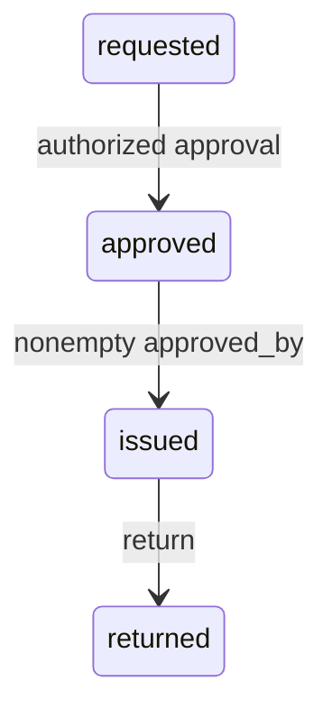

# Engineer A design and proposed handoff contract

Status: implemented by Codex acting as Engineer A; pending Engineer B review and agreement. No partner discussion or review is claimed.

1. A request is a dictionary: `{"id":"A001","fellow_id":"F001","card_type":"visitor","status":"requested","approved_by":null}` in JSON. Python uses `None` for null. Named keys suit this small fixed schema; explicit validation compensates for dictionaries' lack of enforced types.
2. `RequestStore.create_request(fellow_id, card_type)` returns a detached copy of the entire new record. Validation happens before insertion and before incrementing the counter.
3. Invalid business inputs, malformed IDs, unknown IDs and invalid JSON schemas raise `ValueError`. Filesystem failures remain `OSError` (including `FileNotFoundError`). B should catch these at the CLI boundary and offer retry; never catch everything and reset the store.
4. The store owns ID generation. On successful load, the next number is maximum existing ID plus one, not list length. IDs are canonical A001 through A999, then A1000. ASCII digits only. No deletion API is provided. Loading an older backup intentionally restores that snapshot; uniqueness is within the active saved dataset, not across unrelated backups.
5. B creates one `RequestStore` and shares it with workflow functions. `get_request` and `list_requests` return copies. B calls `transition_request(request_id, target_status, approved_by=None)` only after checking approver authorization against a configured staff allowlist. Nonempty is not equivalent to authorized. The storage method enforces legal arrows and record invariants; B must not access `_requests`. Save/load take a path and return `None`.
6. JSON is a list of five-field records. Empty file is corrupt; `[]` is valid empty data. Duplicate JSON keys, duplicate IDs, missing/extra fields, wrong types and impossible status/approver combinations fail. All records validate in staging before replacing the live dataset. A missing file is not a corrupt file: only explicit first-use creation may initialize a new store.
7. Every existing field and next-ID counter must remain unchanged after rejection. Validate a candidate copy before replacing a record. A failed load preserves all memory. A failed save preserves the existing destination through a same-directory temporary file and atomic `os.replace`.

## Legal state machine

Illegal shortcuts include requested to issued, requested to returned and approved to returned. Returned has no outgoing arrows. Compare complete dictionaries before and after failures, not just status.

## Validation, sanitization and limits

Validation rejects unacceptable data. Sanitization changes input (for example trimming whitespace). This implementation checks stripped text for emptiness but preserves accepted identifiers exactly; it does not silently rewrite IDs or card types.

Local JSON is still untrusted: it can be truncated, edited, copied from another system or deliberately altered. Schema checks cannot prove a historical approver was actually authorized; B must define that policy. Single-process operation is supported; simultaneous processes sharing a file are not. Atomic replacement protects against partial writes, but this is not a database or a guarantee against every power-loss scenario.

To test failed save protection, save a valid file, record its bytes, inject a serialization or replacement failure, then verify identical bytes and no leftover temporary file. Automated tests perform both experiments.

## B bug-hunter handoff (predictions; B execution pending)

- Approve with a nonblank unauthorized staff ID: B should reject and preserve every field. Storage alone deliberately cannot determine authorization.
- Approve, issue, return, then approve again: must reject; terminal record and approver stay unchanged. Storage-boundary test verifies the terminal behavior; B still needs wrapper/menu coverage.

Suggested partner cases for A were tested by Codex, not represented as B-authored tests: Unicode numerals are rejected; a valid first record followed by a duplicate/corrupt record leaves the entire live dataset unchanged.

## Assisted integration update

The repair branch implements the proposed store boundary in B's workflow wrappers and `campus_access.cli.run_menu`. A demonstration M01/M02 allowlist rejects unauthorized approvers before mutation. CLI inputs preserve identifiers exactly; only menu selection is trimmed. See `docs/repair-handoff.md` for implementation details and the still-pending human review. B's prior branch is preserved; this is not evidence that B agreed to the interface yet.
